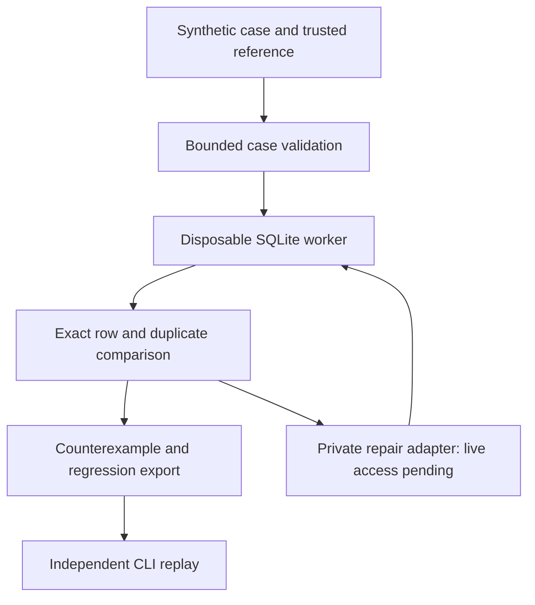

# Rowglass

**Review SQL changes with executable counterexamples.**


[Open the workbench](https://rowglass.adeelfalaksher900.chatgpt.site) · [CLI and case format](docs/CASE-PACKS.md) · [Evaluation](benchmark/README.md) · [PRD](PRD.md) · [TRD](TRD.md) · [Security](SECURITY.md)

Rowglass helps analytics engineers review a behavior-preserving SQL refactor or an AI-written rewrite. Supply a trusted baseline, proposed query and synthetic fixtures. Reproduce a disagreement, inspect missing or unexpected rows, reduce it to a small counterexample, test a repair proposal, and export a regression case another reviewer can run. The browser and repository CLI share the same SQLite evaluator.

The trusted baseline is a declared assumption. For an intentional behavior change, provide reviewed new expectations; a model explanation cannot establish business correctness.

## Current status

Version 0.5 provides local SQL review, selectable executed-fixture tiles, exact duplicate-row differences, reduced regression export and independent offline replay. These local workflows require no provider account or production database.

**The public app is local-only. Actual NVIDIA-on-Nebius inference remains unverified and is a hackathon release gate.** The private adapter has mocked-transport coverage; the displayed reference repairs are hand-authored controls. Provider tests do not establish live accuracy, latency, credits or special-award eligibility. See [the access record](docs/ACCESS-BLOCKER.md), [rule audit](docs/RULES-AUDIT.md) and [validation](docs/VALIDATION.md).


## Quick start

Use Node.js 24 or newer and npm.

```sh
git clone https://github.com/adeelfalaksher900-creator/rowglass.git
cd rowglass
npm ci
npm run check
npm start
```

Open http://localhost:3000. All bundled case data is synthetic.

| Command | Purpose |
| --- | --- |
| `npm test` | Node regression tests |
| `npm run build` | Compile the application |
| `npm run check` | Tests, build and artifact validation |
| `npm run benchmark` | Frozen-corpus control report; no provider call |
| `node scripts/evaluate.mjs` | Built-in local evaluation controls |
| `npm run rowglass -- --help` | Repository CLI reference |

## A review in five minutes

1. Open **Missing customers**. The proposed query drops customers retained by the trusted baseline.
2. Inspect expected/proposed rows and the reduced counterexample. Fixture tiles expose the exact finite checks performed.
3. Choose **Prepare regression case**. Rowglass validates and reruns the reduced reproduction before offering JSON download and copyable text.
4. Load the explicitly labeled hand-authored reference repair, inspect its diff and results, then apply it. This shows review mechanics, not live inference.
5. Run additional seeded fixtures, or open **Your case** and validate the inventory example.
6. Export JSON/Markdown evidence and, when available, a proposed SQL patch. The versioned execution envelope supports independent CLI replay.

Query text is transient unless **Save local draft** is chosen. Restore/forget controls manage one browser draft. A reduced case reproduces an observed disagreement; it does not replace the full suite.

## Architecture



The browser/CLI own execution and the trusted reference. A private repair loop requests a proposal, executes it, and returns bounded visible failures for at most one revision. The reference SQL and full fixture suite stay outside model context. Human approval remains explicit; model output cannot execute shell commands, choose a destination or write a repository.

## Repository CLI

```sh
# Failing proposal: check exits 1 for a mismatch.
node cli/rowglass.mjs check examples/inventory.case.json --out /tmp/proposal

# Trusted query: check exits 0 for finite agreement.
node cli/rowglass.mjs check examples/inventory.case.json \
  --query examples/inventory.good.sql --out /tmp/review

# Digest verification alone does not execute SQL or authenticate a record.
node cli/rowglass.mjs verify /tmp/review.json

# Recompute every recorded fixture/query, without a provider.
node cli/rowglass.mjs replay /tmp/review.json

# Replay can successfully reproduce an originally failing review.
node cli/rowglass.mjs replay /tmp/proposal.json

# Check an exported reduced reproduction.
node cli/rowglass.mjs check downloaded.regression.case.json --out /tmp/regression
```

`check` writes JSON and Markdown using a fresh output prefix. It refuses existing outputs, input collisions and aliases, and requires regular input files. Exit codes are **0** for finite agreement, **1** for mismatch and **2** for invalid input/setup. `replay` checks the digest and execution envelope before recomputing outcomes; success means reproducibility, not that the original query was correct or that a model call occurred. Older reviews without the version 0.3 envelope need a fresh export.

### Bring a synthetic case

Start from [examples/inventory.case.json](examples/inventory.case.json). A `rowglass.case.v1` pack contains a contract, structured table schemas, fixtures, proposed SQL and a trusted reference. The existing `baselineSQL` field means **proposal under test**; `referenceSQL` means **trusted behavioral baseline**. Raw DDL is rejected.

Limits include 6 tables, 16 columns per table, 30 fixtures and 100 input rows per fixture. Columns support integer, real and text; each table starts with an integer primary key, and foreign keys reference an earlier table. See [CASE-PACKS.md](docs/CASE-PACKS.md) for byte limits, formats and CLI behavior.

## Private provider setup

Local checking needs no keys. The server-side names are documented in [.env.example](.env.example):

| Variable | Purpose |
| --- | --- |
| `NEBIUS_API_KEY` | Private Token Factory credential |
| `ROWGLASS_PROVIDER_MODE` | Must explicitly be `private` to allow keyed requests |
| `ROWGLASS_PUBLIC` | Must explicitly be `false`; `true` disables provider/search calls |
| `NEBIUS_MODEL` | Optional `nvidia/...` model override |
| `TAVILY_API_KEY` | Optional official SQLite documentation search |

Supply credentials through the process environment on a trusted loopback Node server/CLI, never browser code or source control. Then a private configured run can use:

```sh
node cli/rowglass.mjs repair examples/inventory.case.json --out /tmp/model-review
```

The fixed inference endpoint is `https://api.tokenfactory.nebius.com/v1/chat/completions`; the documented default model is `nvidia/nvidia-nemotron-3-nano-30b-a3b`. Verify actual catalog availability before a live run. The public Worker unconditionally forces local-only mode, regardless of keys. The private in-memory hourly cap is not durable authorization or a shared quota ledger. Public live inference requires a separately reviewed identity, allowance and concurrency design.

Optional Tavily search uses four fixed generic topics, official SQLite domains and bounded validated HTTPS results. It sends no case SQL, identifiers or rows. Sources explain semantics; they never grade a query or change the trusted reference. Actual Tavily runtime remains unverified.

## Evaluation and boundaries

The [frozen corpus](benchmark/README.md) contains 24 hand-authored changes across six schemas: 18 wrong mutations and six equivalent rewrites. Built-in reference queries, deliberately incorrect repairs and custom inventory fixtures provide separate evaluator controls. The one-shot versus execution-feedback harness separates visible repair feedback from held-out scoring; its current coverage uses injected proposals, without live service results.

- Comparisons preserve duplicate counts and exact column names, including empty outputs; row order is ignored.
- SQLite integer results are supported only within JavaScript's safe integer range. Larger values are rejected rather than rounded. Finite real values use exact comparison, without tolerance.
- A greedy reducer seeks a row-irreducible mismatch under its procedure, not a globally smallest database.
- SQL executes in a disposable browser worker or Node thread with a timeout and bounded outputs. This is not a complete WebAssembly memory sandbox.
- Finite agreement is not universal correctness, a security certification or evidence of business intent.

See [VALIDATION.md](docs/VALIDATION.md) for recorded checks, failure cases and limits. No real-user time savings, adoption study or winning odds are claimed.

## Project map

| Path | Purpose |
| --- | --- |
| `src/engine.mjs`, `src/sql-worker.mjs` | Validation, SQLite execution, comparison and reduction |
| `src/agent.mjs`, `server/api.mjs` | Bounded private proposal/feedback loop |
| `src/evidence.mjs`, `src/regression.mjs` | Portable review and reduced regression evidence |
| `cli/` | Regular-file I/O, checking and independent replay |
| `benchmark/` | Frozen manifest, controls and evaluation protocol |
| `src/App.jsx`, `src/style.css` | Review workbench |
| `tests/`, `docs/` | Regression tests, validation and product/release records |

## Contributing and license

Open a focused issue with synthetic SQL, schema, expected behavior and a minimal fixture. Run `npm run check` and the relevant CLI replay before proposing a pull request. Do not include production rows, credentials or private query material. Changes to provider access must preserve the fail-closed public boundary.

[MIT](LICENSE). Bundled libraries/fonts retain their own licenses: [third-party notices](THIRD-PARTY-NOTICES.md), [license copies](licenses/) and `/licenses.txt`. Development history and assistance are recorded in [the project disclosure](docs/AI-DISCLOSURE.md).
