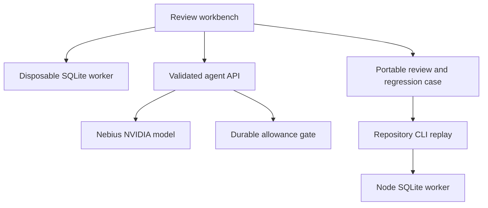

# Rowglass technical requirements

Version 0.4, implementing [PRD.md](PRD.md). Existing source: React 19, sql.js 1.15, Zod 4, portable SHA-256 and an esbuild-produced Worker ESM. No dependency migration is required for the core slices.

## System and trust boundaries



The browser/CLI own synthetic execution and the trusted reference. The provider receives only contract, schema, proposed SQL and bounded visible failures. Model output is untrusted. It cannot select a destination, read files, execute shell commands, write a repository or apply its own patch. API credentials remain server-side. External documentation explains semantics and cannot become an oracle or policy instruction.

## Source layout and commands

- `src/engine.mjs`, `src/case-pack.mjs`, `src/sql-worker.mjs`: validation, execution, comparison and reduction.
- `src/agent.mjs`, `server/api.mjs`: bounded propose/execute/feedback and fixed Token Factory transport.
- `src/evidence.mjs`, `src/review.mjs`, new `src/regression.mjs`: portable evidence and reduced cases.
- `cli/rowglass.mjs`, `cli/evaluate-worker.mjs`, `cli/file-io.mjs`: regular-file IO and isolated repository workflow.
- `benchmark/`, `scripts/benchmark.mjs`: frozen manifest and visible/held-out evaluation.
- `tests/*.test.mjs`: Node built-in tests. `npm test`; `npm run build`; `npm run check`; `npm run rowglass -- --help`.
- `src/App.jsx`, `src/style.css`, `DESIGN.md`, `UX-CONTRACT.md`: UI and visual contracts.
- `tasks/plan.md`, `tasks/todo.md`: dependency order, acceptance and checkpoints.

Prefer readable small functions for new modules. Preserve existing ESM boundaries. Example:

```js
export function supportedInteger(value) {
  if (value < BigInt(Number.MIN_SAFE_INTEGER) || value > BigInt(Number.MAX_SAFE_INTEGER)) {
    throw new Error('SQLite INTEGER output exceeds the supported safe range.');
  }
  return Number(value);
}
```

## Execution fidelity and limits

Retain read-only SELECT/CTE checks, generated typed DDL, bound fixture insertion, foreign-key validation and fresh databases. Read SQLite INTEGERs with `useBigInt:true`, explicitly reject outside the supported safe range, then convert accepted integers to Number. Retain valid REAL output as Number and reject non-finite values before JSON serialization. Explicitly reject unsafe numeric inputs in direct comparison too. The supported output contract excludes arbitrary 64-bit integer fidelity rather than silently rounding it.

Keep eight-second worker termination, 32 columns, 1,000 rows, 10,000-character text cells and one million serialized row characters per query. Disable blob allocation/format functions. The Node JS old-generation cap is not a WebAssembly memory sandbox. Do not expand limits to hide failures. Per-query errors and invalid reference/fixture errors remain distinct.

## Regression case contract

`createRegressionCase(scenario, query, witness)` produces the existing strict `rowglass.case.v1` format. It contains the typed schema, business contract, proposed failing query as `baselineSQL`, trusted `referenceSQL` and one exact valid reduced fixture. Require a non-error divergent witness. Validate, compile and execute the returned pack before download. Missing or agreeing result snapshots cannot manufacture a regression case. A zero-row database is a valid witness if execution still reproduces the disagreement.

The artifact is executable by `node cli/rowglass.mjs check regression.case.json --out fresh-prefix`, which must fail for the original proposal. A supplied passing candidate checked against the same pack must pass. This is a small reproduction, not the entire held-out suite or a guarantee of future correctness. Do not interpolate raw DDL or model text into generated executable code.

## Review replay contract

CLI `replay <review.json>` first verifies the existing digest and validates the data envelope. It then validates the case pack, query, optional candidate and full fixture set represented by the review. Review envelopes must carry a full validated pack and bounded additional fixtures for all evaluated paths, including built-ins/seeded/generated fixtures. A record lacking enough data is rejected as non-replayable with a recovery message.

Recompute the original and optional candidate in isolated workers. Compare fixture identity, constraint/error/pass status and exact canonical expected/actual results, not timestamps, provider latency or reduction execution count. A recomputed digest does not excuse falsified outcomes. Preserve the existing `verify` command as digest-only and label the difference in help and docs. Exit 0 for reproduced evidence, 1 for disagreement, 2 for invalid input/setup. Replay never invokes a provider and never writes input files.

## Agent and status contracts

Keep strict request/reply schemas and fixed HTTPS provider URL. Enforce at most two repair calls or one challenge call. Each proposed fixture is typed, constrained and independently executed. Keep reference/full-suite exclusion. Failure feedback uses only repair-visible fixtures. Query/case changes or cancellation invalidate old candidates and model continuations.

`GET /api/status` reports configuration separately from successful provider observations. A configured key does not enable a provider request unless exact private mode is also permitted; it is not a verified badge. Only a successfully parsed actual provider response establishes an observed call for that execution. Injected test transports never create live-verification evidence. Process memory observation is volatile and explicitly labeled; response metadata is not signed attestation.

Normalize optional model and response identifiers to bounded strings and token counters to safe nonnegative integers. Missing or malformed metadata becomes unknown rather than crashing the UI. Keep generic provider errors and never return credentials or raw upstream error bodies.

## Evaluation architecture

Manifest format: version, frozen case IDs, provenance (hand-authored mutation/equivalent rewrite), taxonomy, typed pack, visible fixture IDs, held-out IDs and candidate SQL. At least six schemas and 24 changes. An offline validator executes trusted references and original candidates, checks constraints and expected positive/negative controls, and records a stable manifest digest.

The repair harness constructs a visible-only scenario. Held-out execution occurs only after the loop stops, using the final candidate, and never enters repair feedback. Reports separate generated challenge fixtures from frozen denominators. Live mode is opt-in, requires actual provider credentials, has explicit call limits and stops at budget exhaustion. Do not start live evaluation implicitly from tests/builds or dashboard load.

## Optional semantic sources

Server accepts an allowlisted topic, not an arbitrary URL/query. Map topics such as `outer-join`, `null-not-in`, `aggregate-duplicates`, `integer-division` to generic official-document queries. Tavily basic search uses a low result cap, no answer generation/raw page dump, official `sqlite.org` domain restriction and a request timeout. Recheck returned HTTPS hostnames before displaying links. Unconfigured requests return a typed unavailable state and make zero calls.

Do not send case SQL, identifiers, fixture values, reference SQL or user identity to search. Do not feed retrieved content into an instruction-bearing system role. Render titles/snippets as text, open links with origin isolation and disclose that citations support explanations, not finite test outcomes.

## Hosted access and persistent data

Local execution remains accountless. Current owner-private hosting and process quota are not a public authorization system. Keep the public inference kill switch until a separately verified durable gate exists.

If a hosted allowance store is provisioned, use a dedicated Supabase project with a private ledger and service-only RPC. A reservation transaction atomically charges the allowance and concurrency slot before provider work. Bind each reservation to an authenticated review principal, nonce, expiry and request digest. Release concurrency in completion/cancellation/timeout paths; consumed provider-call allowance is not refunded merely for a provider error. No caller-provided identity header selects a budget. Apply a global daily ceiling in the same durable transaction. Fail closed on database errors.

All exposed tables require RLS and explicit grants. Anon/authenticated users receive no direct ledger mutation. Privileged functions use a fixed empty `search_path`, qualified identifiers and restricted EXECUTE grants. Service keys stay server-side. Store only allowance counters/reservation metadata, not SQL, fixture rows or review text by default. A backend is optional until public live inference is offered; do not touch the existing unrelated inactive project. Confirm the organization and zero-cost plan before creating infrastructure.

Judge access may use documented review credentials, as the rules allow. Do not share a personal OAuth login. Authenticated access, expiration through judging and actual durable limits require integration tests before enabling public live mode.

## Security and deployment

Preserve no-store API responses, exact route-before-asset handling, restrictive CSP, escaped React rendering, self-hosted assets and immutable hashed static files. Validate local Host independently if hardening the Node adapter; forward disconnect cancellation. Source-only hypotheses remain hypotheses until bounded validation.

Publish exact checked ESM artifact and source SHA through the existing Site workflow, preserving current audience until a separate verified judge deployment is ready. Vercel/Netlify are alternatives if required, not parallel uncontrolled production copies. Never commit `.env`, access credentials, billing screenshots, provider keys or raw private email. Public GitHub mirrors the reviewed source with MIT and dependency/font notices.

## Test strategy and release checks

| Layer | Checks | Evidence |
|---|---|---|
| Pure/contracts | Numeric boundaries, schema constraints, multiset comparison, digest, regression builder, replay comparison, topic allowlist | Deterministic Node tests |
| Worker/CLI | Errors/timeouts/recovery, no overwritten files, large review round trip, replay disagreement, regression case rerun | Isolated Node subprocesses and unique temporary directories |
| Transport | Schema/body/origin guards, provider failures, malformed metadata, public gate, cancellation and mocked Tavily responses | In-memory Request and injected transport; labeled mocks |
| Evaluation | Frozen manifest/positive-negative controls and held-out exclusion | Offline report with manifest digest; separate actual live report |
| UI | Every primary function at desktop/mobile, focus, keyboard, invalid/import/empty/error/loading/cancel states and exports | Fresh browser observations/screenshots |
| Deployment | Exact version, no secret leakage, judge access, server state and real model call | Native deploy result and actual runtime record |

Tests lock in user-visible failures, not line counts or superficial render snapshots. Run relevant checks per slice, then `npm run check` once the combined source is stable. Do not claim every possible function/path or 100% security. Formal security-audit completion remains a separate documented requirement where explicitly requested.

## Remaining external questions

Nebius-approved access/credits for Pakistan; optional Tavily activation; isolated backend organization/free-plan confirmation if needed; factual team eligibility; final legal submission confirmation. Continue independent implementation while these are unresolved, but do not generate final media or submit an unqualified project.


## v0.4 provider and UI contract

The public Worker passes an overriding `{...env, ROWGLASS_PROVIDER_MODE: 'local-only', ROWGLASS_PUBLIC: 'true'}` to the API. Neither forged identity headers nor environment keys can enable an outbound provider call. The deployed ESM validator exercises 16 flag combinations with dummy keys and observes zero calls for both routes. Direct API use requires `ROWGLASS_PROVIDER_MODE=private`; missing/unknown values disable access. `ROWGLASS_PUBLIC=true` overrides private mode. This mode is for a trusted loopback server, not public authorization.

Status exposes key configuration, access permission and observation separately. Observed responses are scoped to the current key/model configuration. The fixed model transport rejects redirects, limits the complete UTF-8 response to 128 KiB, enforces one 60-second deadline over headers and body and cancels failed/oversized streams. Only generic error states reach the UI. No provider data is fetched during checks/build.

Reference loading clears earlier candidate evidence before evaluation. Candidate and report commit together only after successful execution and while the revision remains current. SQL syntax coloring is a source-preserving presentation layer over the labeled native textarea; the evaluator remains the only execution authority. Browser QA must check editing, scrolling, focus, forced-colors fallback source and responsive pane transformation.
