# Rowglass gallery

Fourteen real browser captures of the v0.5 local workbench and one source-based architecture diagram. Captured 19 October 2026. The diagram is an implementation description, not observed provider execution. All shown repairs are hand-authored references. Live NVIDIA-on-Nebius runtime is pending.

## 01

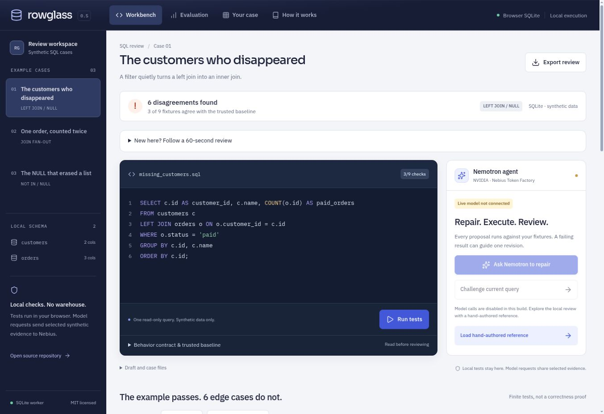

3/9 fixtures agree. Local SQLite runs without an account; live Nebius inference remains pending.

## 02

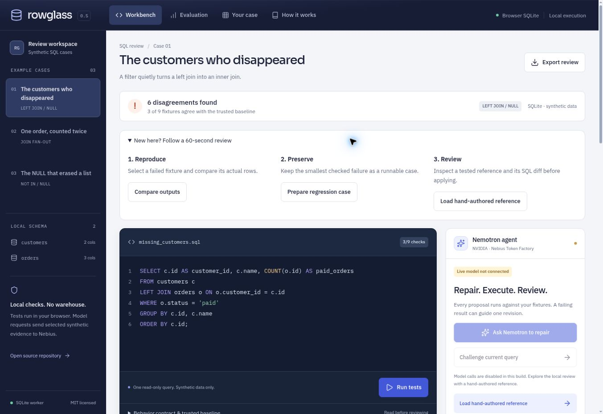

Compare real outputs, preserve a regression case, then inspect a tested reference repair.

## 03

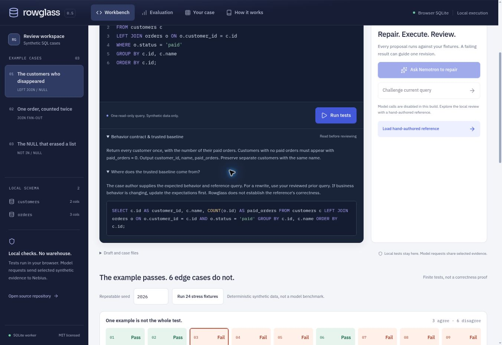

An explicit behavior contract and readable baseline. Rowglass checks execution, not business intent.

## 04

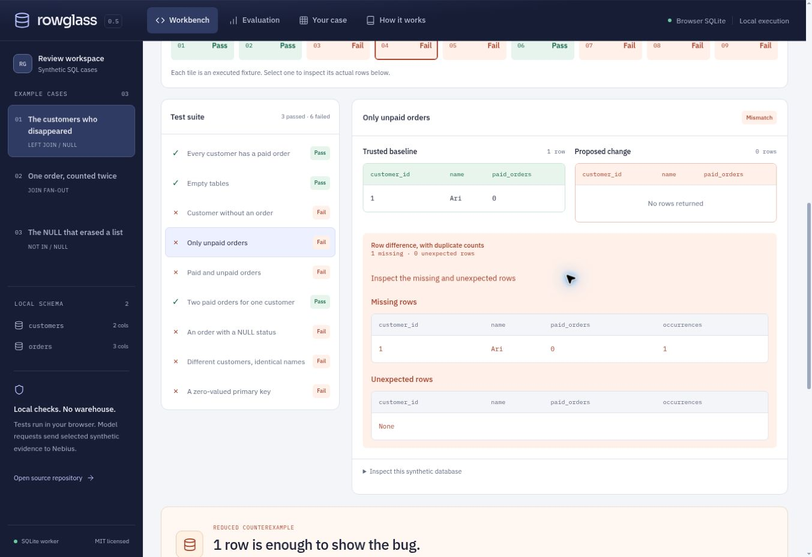

Ari is missing from the proposed output. Inspect exact missing rows and duplicate occurrences.

## 05

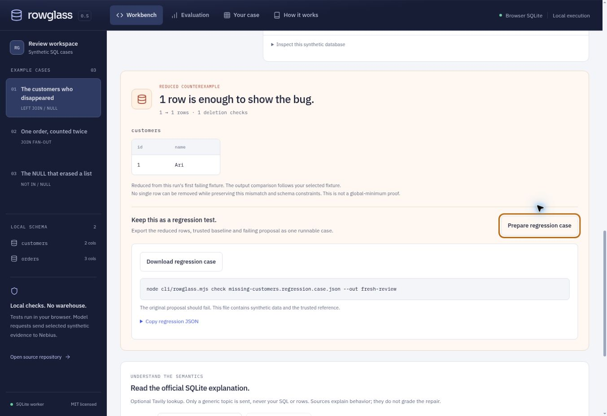

One customer row reproduces the bug. Export the verified regression case and rerun it through the CLI.

## 06

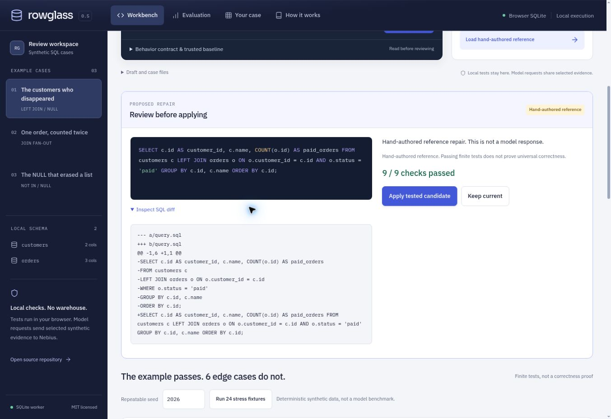

Hand-authored reference: 9/9 finite checks agree. Inspect the SQL diff before approving.

## 07

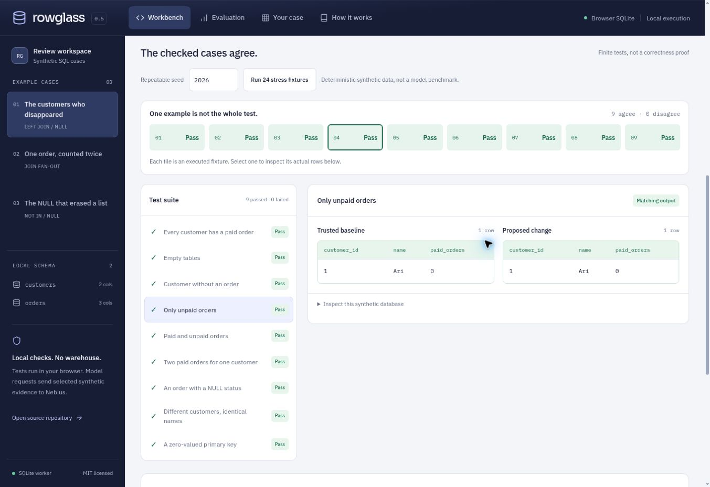

Reference applied locally. All nine curated checks agree; no production database is connected.

## 08

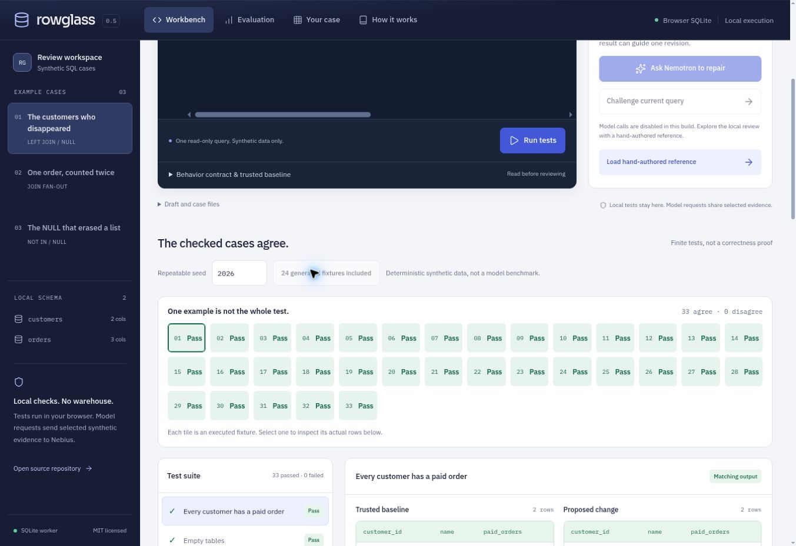

Seed 2026 adds 24 deterministic fixtures. The reference agrees on 33/33 finite checks, not a model benchmark.

## 09

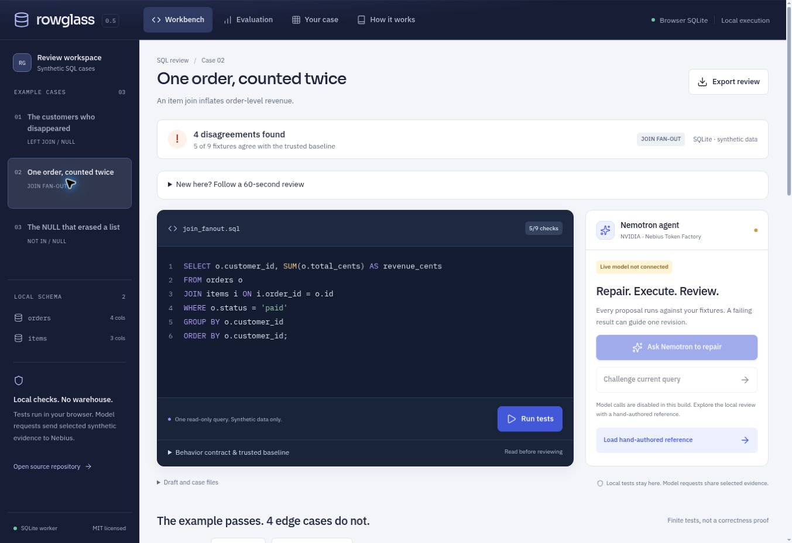

Join fanout incident: independent fixtures expose an inflated total that the everyday example misses.

## 10

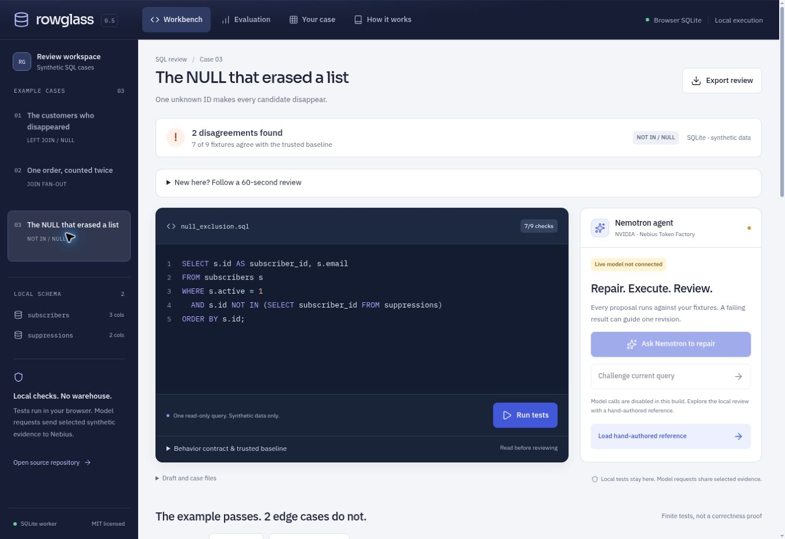

NULL-sensitive exclusion: inspect how a NOT IN rewrite changes the expected customer list.

## 11

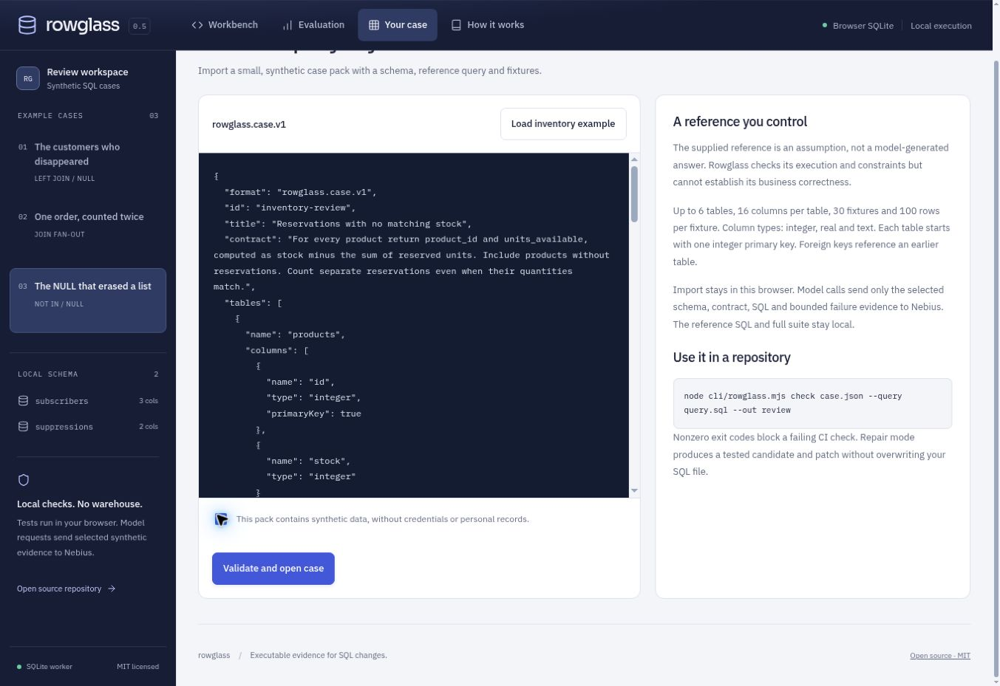

Import a typed, synthetic inventory case. The reference query and full fixture suite remain local.

## 12

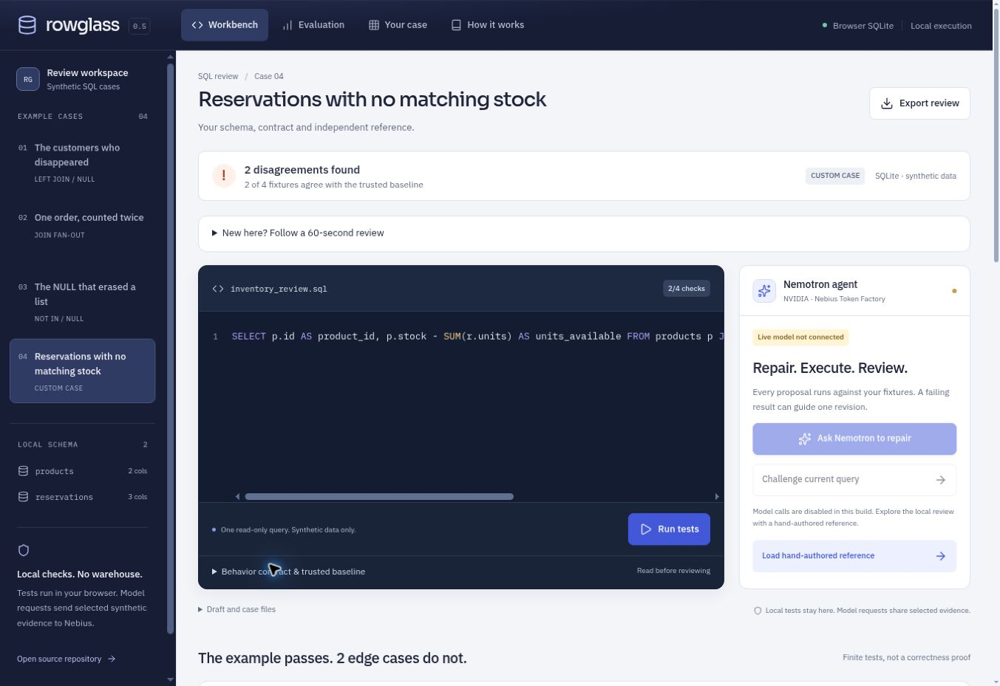

Imported inventory review: the proposed query agrees on 2/4 fixtures. Inspect its query and measured result.

## 13

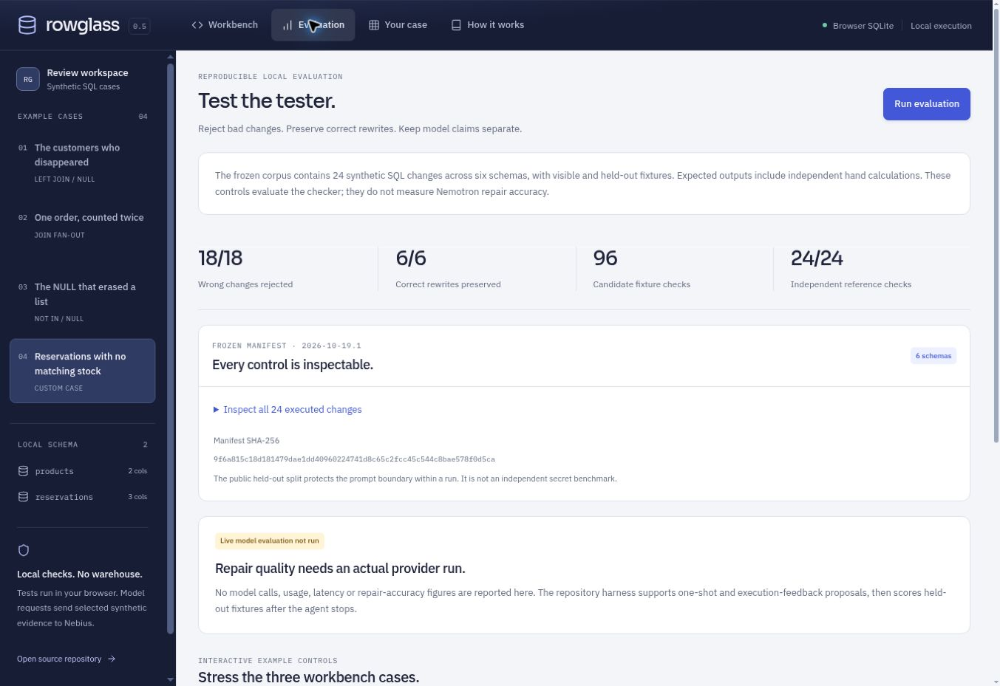

Offline controls: 18 wrong changes rejected, six valid rewrites preserved. These do not measure Nemotron accuracy.

## 14

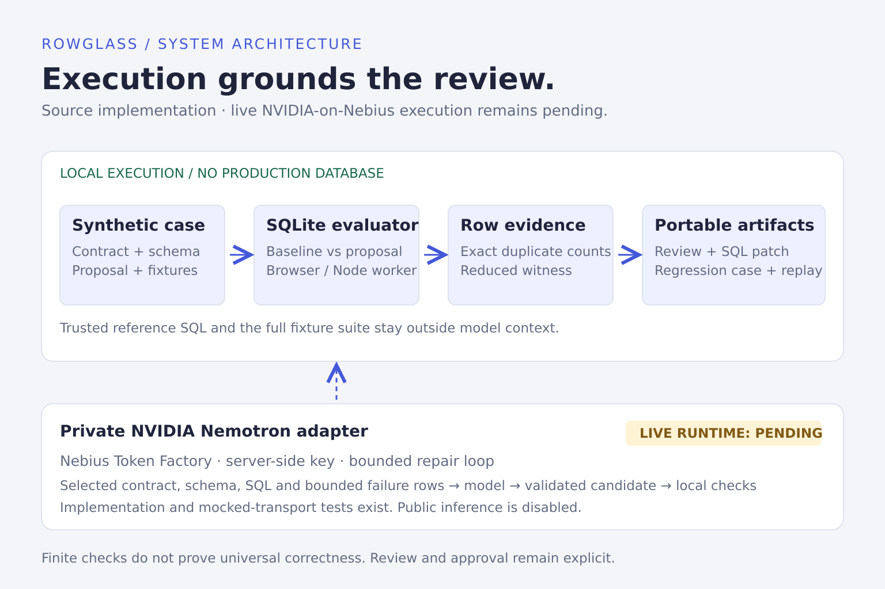

Architecture: local execution and portable evidence, with a private NVIDIA-on-Nebius path awaiting access.

## 15

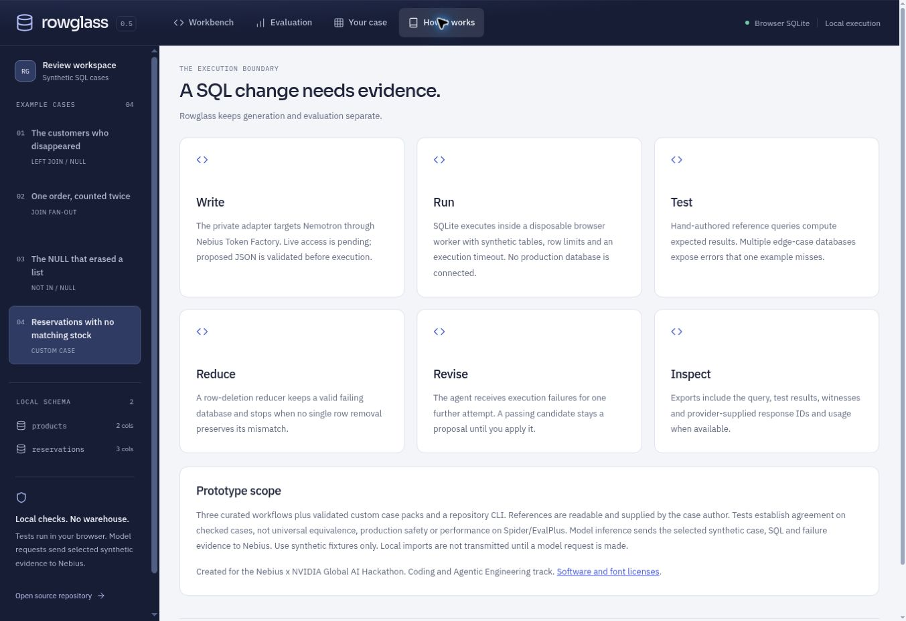

Generation and evaluation stay separate. Repairs require explicit review; actual Nebius runtime is pending.

